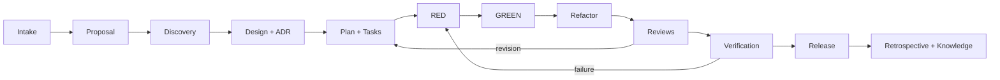

# Agentic Development Scaffold

A public-safe, Markdown-first software delivery scaffold for humans, GitHub Copilot, and other coding agents. It turns an idea into traceable evidence through proposal, discovery, design, ADRs, bite-sized tasks, strict TDD, independent reviews, verification, release, and knowledge write-back.

## What this repository provides

- `AGENTS.md`: repository-wide operating contract for humans and agents.
- `.github/copilot-instructions.md`: concise GitHub Copilot guidance.
- `.github/agents/`: specialized custom-agent profiles for GitHub Copilot cloud agent and supported IDE surfaces.
- `.github/prompts/`: reusable lifecycle slash commands for local VS Code Copilot agents.
- `.github/instructions/`: path-specific instructions.
- `workflows/`: the complete delivery lifecycle, with entry/exit gates and evidence.
- `01-product/` to `04-delivery/`: durable product, knowledge, architecture, and delivery records.
- `scripts/validate_scaffold.py`: zero-dependency structural and safety validator.

## Start a project

1. Use this repository as a template or copy it into a new repository.
2. Replace the example feature with your first real feature package.
3. Add immutable source material to `raw/` and register it in `raw/index.md`.
4. Start with `.github/prompts/00-intake.prompt.md` or the `orchestrator` agent.
5. Do not implement until proposal, design, plan, acceptance criteria, and required ADRs pass their gates.
6. Use strict RED-GREEN-REFACTOR and preserve command output as verification evidence.
7. Run `python3 scripts/validate_scaffold.py` and `uv run --extra test pytest` before every PR.

## Lifecycle

## Human authority

Agents may analyze, propose, edit, test, and review within an approved task. Humans retain authority over scope, risk acceptance, architecture decisions, credentials, production deployment, destructive actions, and merge approval.

## Copilot surface compatibility

GitHub Copilot cloud agent consumes repository instructions and `.github/agents/*.agent.md` profiles. VS Code local agents additionally discover `.github/prompts/*.prompt.md` as explicit slash commands; current Agent Host cloud runs do not consume prompt files. The Markdown lifecycle under `workflows/` remains the vendor-neutral source, so a workflow is not lost when a Copilot surface lacks prompt-file support.

Official references:

- [GitHub: repository custom instructions](https://docs.github.com/en/copilot/customizing-copilot/adding-repository-custom-instructions-for-github-copilot)
- [GitHub: custom agents for Copilot cloud agent](https://docs.github.com/en/copilot/how-tos/copilot-on-github/customize-copilot/customize-cloud-agent/create-custom-agents)
- [VS Code: prompt files](https://code.visualstudio.com/docs/agent-customization/prompt-files)

## Public repository safety

This template contains no organization-specific domains, credentials, account IDs, host paths, or infrastructure details. Keep project secrets in approved secret stores, never Markdown or Git history.

## License

MIT. See `LICENSE`.
